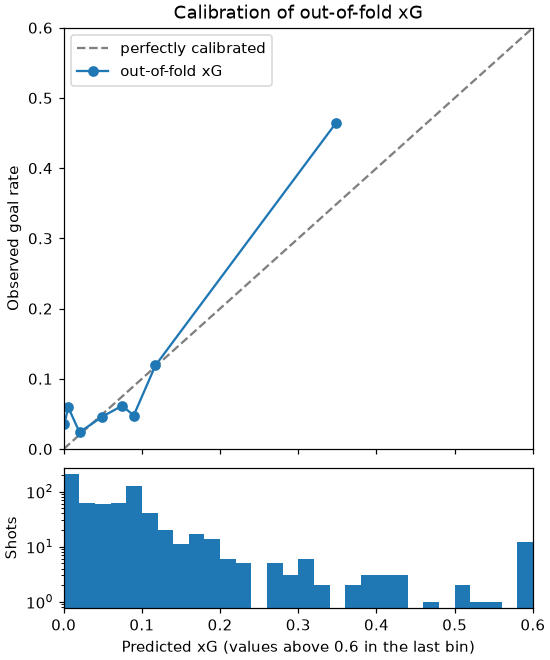
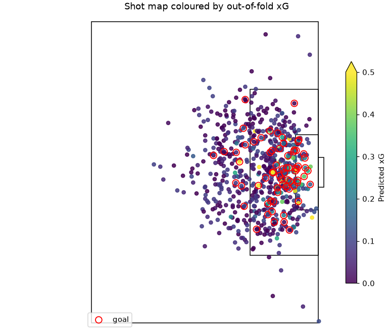

# xg_prediction

Expected goals (xG) model for football shots, trained on the open StatsBomb event data of the Bundesliga 2015/16 season.

## Problem

Expected goals estimates the probability that a shot results in a goal, given the situation in which it was taken: where on the pitch, with which body part, under which pressure and with which defenders and goalkeeper in the way. Because goals are rare and noisy, xG is a more stable measure of chance quality than the scoreline and is widely used to evaluate teams and players. This project trains a gradient-boosted classifier on engineered shot-level features and checks both its ranking quality (ROC-AUC) and its probability quality (log loss, calibration).

## Data

Shots come from the [StatsBomb open data](https://github.com/statsbomb/open-data) (competition 9, season 27), downloaded with [`statsbombpy`](https://github.com/statsbomb/statsbombpy). The open release of this season covers 34 matches, giving 840 shots (goal rate 10.7%) after removing penalty shootouts. `xg_prediction.dataset` splits them into a stratified 80/20 `train.csv` (672 shots) and `test.csv` (168 shots). The outcome and StatsBomb's own xG value are not part of the tables.

Data provided by [StatsBomb](https://statsbomb.com). Use of the data is subject to the [StatsBomb open data licence](https://github.com/statsbomb/open-data/blob/master/LICENSE.pdf), which asks users to credit StatsBomb as the source.

## Features

Built in `xg_prediction/features.py` from the StatsBomb shot event and its freeze frame (the positions of all visible players at the moment of the shot):

| Feature | Description |
| --- | --- |
| `shot_distance` | Distance from the shot to the nearest point of the goal mouth |
| `shot_angle` | Angle subtended by the two goalposts at the shot location |
| `nearest_defender_dist` | Distance to the nearest opposing outfield player |
| `defenders_in_lane` | Opponents inside a 2.5 yard corridor between shot and goal centre |
| `defenders_in_radius` | Opponents within 5 yards of the shooter |
| `goalkeeper_distance`, `goalkeeper_off_center` | Distance to the goalkeeper and its lateral offset from the goal centre |
| `position_role`, `position_side`, position flags | Role and side derived from the shooter's position |
| StatsBomb shot attributes | Shot type, technique, body part, play pattern, under pressure, first time, one-on-one, open goal, minute, period, ... |

Categorical columns are one-hot encoded and identifier and free-text columns are dropped in `preprocessing_pipeline` (`xg_prediction/modeling/train.py`).

## Model and validation

An `XGBClassifier` (`binary:logistic`, `hist` tree method) configured in `conf/model/xgboost.yaml`: 300 trees, depth 4, learning rate 0.1, early stopping after 50 rounds. Runs are configured with [Hydra](https://hydra.cc), hyperparameters can be searched with the Optuna sweeper, and runs are tracked with MLflow. Validation is stratified 5-fold cross-validation on the training table (seed 42); every shot receives one out-of-fold prediction, which feeds the figures below. The hold-out `test.csv` is only used by `predict`.

## Results

Default parameters, no hyperparameter sweep. Mean and standard deviation over the 5 folds:

| Metric | Model | Constant baseline (10.7%) |
| --- | --- | --- |
| ROC-AUC | 0.827 ± 0.032 | 0.500 |
| Log loss | 0.303 ± 0.033 | 0.340 |



Predicted probabilities track the observed goal rate for low-probability shots; the highest-probability bin (mean xG 0.35) converts at 46%, so large chances are under-predicted.



High xG concentrates in the central area close to goal, as expected. Goals are ringed in red.

## How to run

Requires Python 3.11+ and [Poetry](https://python-poetry.org).

```bash
poetry install

# 1. Download shots and write data/raw/{train,test}.csv
poetry run python -m xg_prediction.dataset

# 2. Build features into data/processed/
poetry run python -m xg_prediction.features

# 3. Cross-validated training with the default parameters
poetry run python -m xg_prediction.modeling.train

# 4. Figures in reports/figures/ (from the out-of-fold predictions of step 3)
poetry run python -m xg_prediction.plots

# 5. Train the final model on all training shots and predict the hold-out table
poetry run python -m xg_prediction.modeling.train mode=final
poetry run python -m xg_prediction.modeling.predict

# Optional: Optuna sweep over learning rate, depth and number of trees
poetry run python -m xg_prediction.modeling.train --multirun data.oof_path=null
```

Lint and tests: `poetry run ruff check && poetry run ruff format --check && poetry run pytest`.

### Experiment tracking

By default MLflow logs to `./mlruns` (gitignored); browse it with `poetry run mlflow ui`. Remote tracking on DagsHub is opt-in and needs access to that repository:

```bash
poetry run python -m xg_prediction.modeling.train tracking.remote=true
poetry run python -m xg_prediction.modeling.predict --remote-tracking
```

DagsHub asks for a login on first use; alternatively set `DAGSHUB_USER_TOKEN`. No credentials are stored in the repository.

## Project structure

```
conf/                  Hydra configuration (config.yaml, model/xgboost.yaml)
data/                  Generated raw and processed tables (gitignored)
notebooks/             Exploratory notebooks
reports/figures/       Figures used in this README
tests/                 Feature geometry and preprocessing tests
xg_prediction/
  dataset.py           Download StatsBomb shots and split into train/test
  features.py          Feature engineering
  plots.py             Calibration plot and shot map
  tracking.py          MLflow setup (local by default, DagsHub opt-in)
  modeling/train.py    Preprocessing, cross-validation, final model
  modeling/predict.py  Inference with the registered model
```

## Limitations

- Small sample: 672 training shots with 72 goals. Fold metrics vary noticeably (ROC-AUC 0.78 to 0.88) and the second decimal should not be over-interpreted. The open release only contains this season's matches of one club, so results do not generalise to other teams or leagues.
- Cross-validation splits shots at random, not by match, so shots from the same match can sit on both sides of a split.
- Numeric identifier columns such as `match_id`, `team_id` and `player_id` are not removed by the preprocessing and can let the model memorise teams and players.
- Early stopping monitors the validation fold of the cross-validation, which makes the reported metrics slightly optimistic.
- Only five penalties are in the training table, so penalty probabilities are not modelled separately.
- Hyperparameters are the configured defaults; a sweep was not run for the reported numbers.
